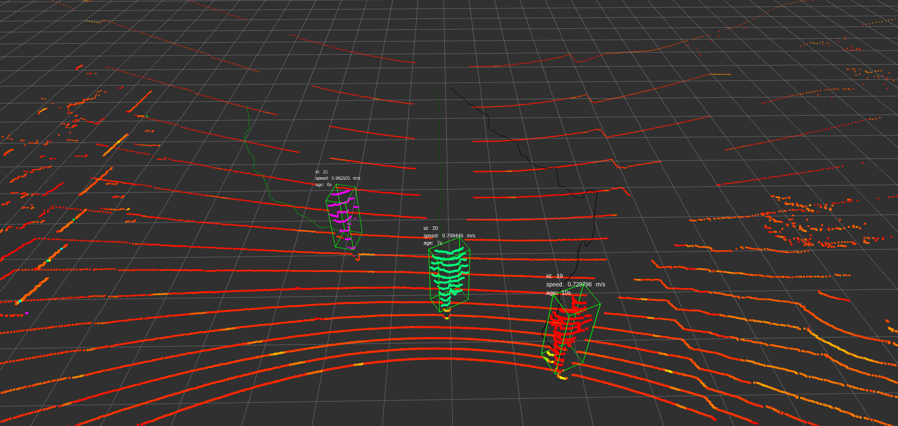

# lidar_perception

A lidar perception system of autonomous vehicle, includeing coordinate transformation by urdf，　ground filter, cluster(region growing cluster, euclidean cluser, 2D dbscan cluster), minbox, hm_tracker, state estimation.

